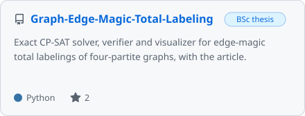
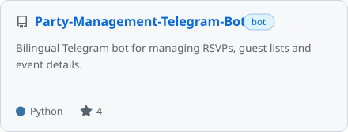

<picture>
  <source media="(prefers-color-scheme: dark)" srcset="assets/banner-dark.svg">
  
</picture>

<p align="center">
  <a href="https://linkedin.com/in/bardia-yaghmaie"></a>
  <a href="https://github.com/kubernetes-sigs/krew-index/pull/5095"></a>
</p>

Hey, I'm Bardia 👋

I'm an SRE at Yektanet. Day to day that means keeping a whole lot of Kubernetes happy, and when it isn't, being the one who digs in and figures out why. I love both sides of the job, the infra and the security, and I've got a habit: if I need a tool and it doesn't exist yet, I build it. Most of what you'll find here started exactly like that.

### Stuff I built because I needed it

Editing a Kubernetes Secret used to drive me a little crazy. Decode, edit, re-encode, pray you didn't sneak a newline in there, repeat. So I wrote [**kubectl-edit-secret**](https://github.com/BardiaYaghmaie/kubectl-edit-secret): it opens the Secret in your editor as plain text, encodes it back when you save, and shows you exactly what changed. Then I opened a [PR to krew-index](https://github.com/kubernetes-sigs/krew-index/pull/5095), and honestly, seeing it merged into kubernetes-sigs was one of my favorite days as an engineer. Now anyone can grab it with one line, and people I've never met are using it, starring it and opening issues on it. That part never gets old.

```bash
kubectl krew install edit-secret
```

[**bardiup**](https://github.com/BardiaYaghmaie/bardiup) is the backup version of the same story. I wanted PVC backups where every team handles its own namespace with a few lines of YAML, where you keep the copies you actually care about (last 24 hours, 7 days, 4 weeks, 12 months, 5 years) and everything else gets cleaned up, and where the backups are just plain `tar.gz` files in S3. No special tool needed to restore, ever. It's a small Go operator, and building it taught me more about controller-runtime than any doc ever did.

A couple more I'm proud of: [**pingate**](https://github.com/BardiaYaghmaie/pingate), a Rust reverse proxy on Pingora that discovers Docker Compose and Swarm containers by their labels, and [**distributed-n8n-on-k8s**](https://github.com/BardiaYaghmaie/distributed-n8n-on-k8s), a highly available n8n setup I wrote to actually be read, with a comment on every non-obvious line telling you why it's there.

And that's what I love about open source. You scratch your own itch, share it, and find out a bunch of people had the exact same itch. Issues, PRs and ideas are always welcome on any of these!

<p align="center">
  <a href="https://github.com/BardiaYaghmaie/kubectl-edit-secret"><picture><source media="(prefers-color-scheme: dark)" srcset="assets/cards/kubectl-edit-secret-dark.svg"></picture></a>
  <a href="https://github.com/BardiaYaghmaie/bardiup"><picture><source media="(prefers-color-scheme: dark)" srcset="assets/cards/bardiup-dark.svg"></picture></a>
  <a href="https://github.com/BardiaYaghmaie/pingate"><picture><source media="(prefers-color-scheme: dark)" srcset="assets/cards/pingate-dark.svg"></picture></a>
  <a href="https://github.com/BardiaYaghmaie/distributed-n8n-on-k8s"><picture><source media="(prefers-color-scheme: dark)" srcset="assets/cards/distributed-n8n-on-k8s-dark.svg"></picture></a>
  <a href="https://github.com/BardiaYaghmaie/Graph-Edge-Magic-Total-Labeling"><picture><source media="(prefers-color-scheme: dark)" srcset="assets/cards/Graph-Edge-Magic-Total-Labeling-dark.svg"></picture></a>
  <a href="https://github.com/BardiaYaghmaie/Party-Management-Telegram-Bot"><picture><source media="(prefers-color-scheme: dark)" srcset="assets/cards/Party-Management-Telegram-Bot-dark.svg"></picture></a>
</p>

### At work

At [Yektanet](https://www.yektanet.com), Iran's largest ad-tech network, we run 4 Kubernetes clusters with 200+ nodes handling 50k+ requests a second. A few things I got to work on that I'm really happy about:

- **Going multi-cloud in three months.** We stood up a second cluster on another provider running active-active with the first, with Redis, PostgreSQL and Kafka replicating between them. The best moment? The live failover, when the second cluster took the full 50k req/s on its own and didn't even blink.
- **Kavosh**, an AI security agent I built. It reads our production code hunting for vulnerabilities, then a second team of agents tries its best to prove each finding wrong. Only what survives gets a drafted fix for a human to approve. So far its fixes have closed 40+ bugs across 15+ services, 20+ of them CVSS 7 or higher.
- **Our private bug bounty.** I triaged 70+ valid reports from outside researchers. Super humbling, and super fun.
- **Disaster recovery.** Backups we've actually restored, and playbooks ready for the day we need them.

These days I'm helping build an on-prem bare-metal cluster. Before Yektanet I did DevSecOps at Dotin, a core-banking software vendor, and before that I built the whole infra at Active Cleaners, an online laundry startup, starting from the very first VM.

### Outside of work

I wrapped up my BSc in Computer Science at Iran University of Science and Technology this year. My thesis was on edge-magic total labelings of four-partite graphs, half math proofs and half CP-SAT solver, and the article, solver and visualizer are all [open source](https://github.com/BardiaYaghmaie/Graph-Edge-Magic-Total-Labeling). I also co-wrote a study on the post-quantum key exchange behind Apple's iMessage PQ3 with a classmate.

Teaching ended up being one of the best parts of uni for me. I TA'd five courses and ran Kubernetes, Docker and Git workshops for other students, and I'd jump at the chance to do it again.

### What I work with

<table>
  <tr>
    <td align="center" width="33%"><b>Platform</b><br><br><br><sub>Helm &middot; Argo CD &middot; Cilium &middot; Vault &middot; Bazel</sub></td>
    <td align="center" width="33%"><b>Observability</b><br><br><br><sub>VictoriaMetrics &middot; Loki &middot; Alertmanager</sub></td>
    <td align="center" width="33%"><b>CI/CD</b><br><br><br><sub>Gerrit &middot; GitOps</sub></td>
  </tr>
  <tr>
    <td align="center"><b>Data</b><br><br><br><sub>CloudNativePG</sub></td>
    <td align="center"><b>Code</b><br><br><br><sub>controller-runtime &middot; Pingora &middot; OR-Tools</sub></td>
    <td align="center"><b>Security</b><br><br><sub>Trivy &middot; Wazuh &middot; Keycloak<br>FortiWeb &middot; SAST &middot; bug bounty triage</sub></td>
  </tr>
</table>

Always happy to chat about SRE, Kubernetes, security or open source, so feel free to reach out on [LinkedIn](https://linkedin.com/in/bardia-yaghmaie)!

<picture>
  <source media="(prefers-color-scheme: dark)" srcset="https://raw.githubusercontent.com/BardiaYaghmaie/BardiaYaghmaie/output/github-snake-dark.svg">
  
</picture>
