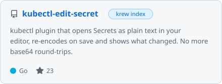
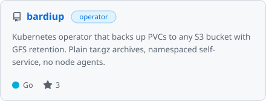
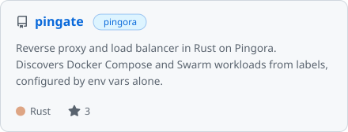
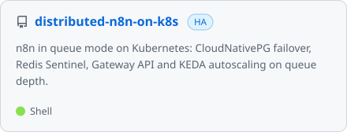

<picture>
  <source media="(prefers-color-scheme: dark)" srcset="assets/banner-dark.svg">
  
</picture>

<p align="center">
  <a href="mailto:yaghmaiebardia@gmail.com"></a>
  <a href="https://linkedin.com/in/bardia-yaghmaie"></a>
  <a href="https://github.com/kubernetes-sigs/krew-index/pull/5095"></a>
</p>

Hey, I'm Bardia 👋 I keep a whole lot of Kubernetes happy for a living, and when I need a tool that doesn't exist yet, I build it.

- 🛠️ **SRE at [Yektanet](https://www.yektanet.com).** I took Yektanet multi-cloud at 200+ nodes and 50k+ req/s, built its AI security agent, and do plenty more SRE fun along the way.
- 🚀 **Building [Konda](https://kondaai.com), my startup.** A vibe-coding platform: describe the app you want, and Konda builds it and hosts it for you. My title there is Chief "Fix It In Prod" Officer, and yes, it's accurate.
- 🎓 **Giving back.** I've contributed to DevOps contests with 400+ students.

### Open source, my favorite hobby

Editing a Kubernetes Secret used to drive me crazy: decode, edit, re-encode, pray you didn't sneak in a newline. So I wrote **kubectl-edit-secret**, and seeing it merged into [kubernetes-sigs/krew-index](https://github.com/kubernetes-sigs/krew-index/pull/5095) was one of my best days as an engineer. Then came **bardiup**, a tiny operator that backs up your PVCs to S3 and keeps just the copies you care about.

```bash
kubectl krew install edit-secret
```

<p align="center">
  <a href="https://github.com/BardiaYaghmaie/kubectl-edit-secret"><picture><source media="(prefers-color-scheme: dark)" srcset="assets/cards/kubectl-edit-secret-dark.svg"></picture></a>
  <a href="https://github.com/BardiaYaghmaie/bardiup"><picture><source media="(prefers-color-scheme: dark)" srcset="assets/cards/bardiup-dark.svg"></picture></a>
  <a href="https://github.com/BardiaYaghmaie/pingate"><picture><source media="(prefers-color-scheme: dark)" srcset="assets/cards/pingate-dark.svg"></picture></a>
  <a href="https://github.com/BardiaYaghmaie/distributed-n8n-on-k8s"><picture><source media="(prefers-color-scheme: dark)" srcset="assets/cards/distributed-n8n-on-k8s-dark.svg"></picture></a>
</p>

**Got a side project collecting dust?** Send it my way, I'd genuinely love to see it. Maybe we bring it back to life together.

### What I work with

<p align="center">
  
</p>

<p align="center">
  Reach me at <a href="mailto:yaghmaiebardia@gmail.com"><b>yaghmaiebardia@gmail.com</b></a> or on <a href="https://linkedin.com/in/bardia-yaghmaie">LinkedIn</a>. Always up for talking SRE, security, AI agents or open source!
</p>

<picture>
  <source media="(prefers-color-scheme: dark)" srcset="https://raw.githubusercontent.com/BardiaYaghmaie/BardiaYaghmaie/output/github-snake-dark.svg">
  
</picture>
